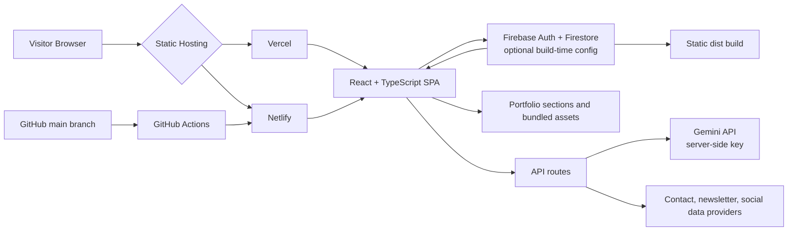

# Kalyan Saragadam — AI Engineer & Full Stack Developer

Personal portfolio for AI engineering, GenAI, agent workflows, and full-stack projects. Built with React 19, TypeScript, Vite 8, Tailwind CSS, Firebase, and Gemini server routes.

## Live deployments

| Host | Production URL | Status |
| --- | --- | --- |
| Vercel | https://portfolio-three-delta-j35dmdk1bg.vercel.app | Live |
| Netlify | https://joyful-pegasus-f68efd.netlify.app | Live |
| Firebase Hosting | https://elated-garden-472910-m2.web.app | Live |

The Vercel project alias may also resolve at https://portfolio-kalyan870s-projects.vercel.app. The primary URL above is the production alias returned by the successful deployment.

Cloudflare Pages and Deno Deploy are not active: this environment has no Cloudflare API token or Deno Deploy token. Their workflows can be added once credentials are available.

## Architecture



The frontend is a static Vite build in `dist/`. Vercel, Netlify, and Firebase Hosting serve the current production builds. Firebase and server-backed integrations require deployment environment variables; static hosting alone does not activate the Express API routes.

## Screenshots

The deployed site includes screenshots and illustrations in its app assets under `public/assets/aistudio/`. Open the [live portfolio](https://portfolio-three-delta-j35dmdk1bg.vercel.app/) for the current UI. A fresh browser capture could not be exported as a repository image in this environment.

## Local development

Requirements: Node.js 24.x and npm.

```bash
npm install --legacy-peer-deps
npm run dev
```

Create a local `.env` from `.env.example` to enable integrations. Do not commit local environment files or provider credentials.

## Build

```bash
npm run build
npm run preview
```

The project uses Vite 8 with esbuild 0.28. CI installs use `--legacy-peer-deps` for the current upstream peer dependency graph.

## Deployment configuration

Vercel uses `vercel.json`; Netlify uses `netlify.toml`. Cloudflare Pages can publish the same static `dist/` output with build command `npm install --legacy-peer-deps && npm run build`.

Firebase sign-in and saved bookmarks need these build-time variables on the host:

- `VITE_FIREBASE_API_KEY`
- `VITE_FIREBASE_AUTH_DOMAIN`
- `VITE_FIREBASE_PROJECT_ID`
- `VITE_FIREBASE_STORAGE_BUCKET`
- `VITE_FIREBASE_MESSAGING_SENDER_ID`
- `VITE_FIREBASE_APP_ID`
- `VITE_FIREBASE_DATABASE_ID`

Server integrations may need `GEMINI_API_KEY`, `RESEND_API_KEY`, or newsletter provider credentials. Keep those server-side; never use a `VITE_` prefix for private credentials.

### GitHub Actions secrets

The Netlify workflow uses `NETLIFY_AUTH_TOKEN` and `NETLIFY_SITE_ID`. It also accepts the Firebase variables above as repository secrets.

## Repository scope

AI Studio working artifacts, generated Firebase project configuration, draft rules, local environment files, dependencies, and build outputs are excluded. Configure your own Firebase project and review its security rules before enabling authenticated storage.
